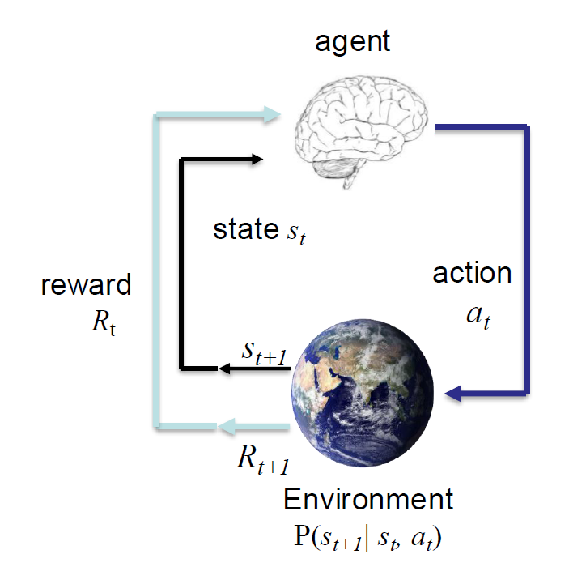

# MDP

## Define

An Finite MDP is defined by:
- A finite set of states $s \in S$
- A finite set of action $a \in A$
- A transition function $T(s, a, s')$
   - Probablity that a fprm S leads to $s'$, ie. $P(s'|s,a)$
   - also called the model or the dynamics
- A reward function $R(s)$ (Sometimes R(s,a) or R(s,a,s'))
- A start state
- Maybe a terminal state

  

we have $||V||_{\infin} = \underset{s}{max} |V(s)| $, ||V|| is norm

$BV(k) = R(s) + \gamma \underset{a \in A}{\text{max}} \underset{s' \in S}{\sum} P(s'|s,a)V(s')$

$B_{\pi}V(s) = \mathbb{E}_{a\sim\pi}[R(s,a) + \gamma \underset{s' \in S}{\sum} p(s'|s,a) V(s')]$

